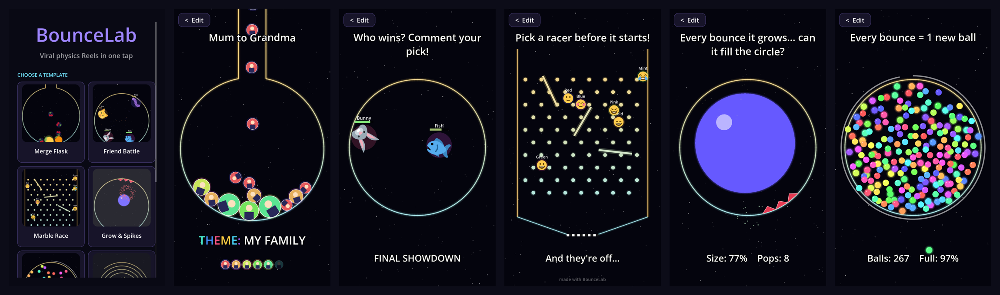

# BounceLab

**Viral physics Reels in one tap.** Pick a template, drop in your own photos or an emoji pack, write a hook, and export a ready-to-post 1080x1920 video with sound.



## Templates

| Template | What happens | Why people watch |
|---|---|---|
| **Merge Flask** | Balls stream down a neon flask; two of a kind merge into the next level | Clear goal + progress ladder = "I have to see the final one" |
| **Friend Battle** | Your friends (photos) crash into each other; health bars, crits, last one standing wins | People pick a side and comment their bet |
| **Marble Race** | Racers drop through pegs and spinning bars to a chequered finish | "Pick a racer" - viewers bet in the comments |
| **Grow & Spikes** | The ball grows every bounce, spikes cut it in half | Near-misses and setbacks before the payoff |
| **Fill the Circle** | Every bounce spawns a new ball until the circle is full | Exponential chaos + a % meter |
| **Escape the Rings** | Spinning rings with gaps; each escape shatters a ring | "Will it get out?" open loop |
| **Melody Bounce** | Each bounce plays the next note of a song | "Guess the song" comments |

Every template shares the same look (space background, neon glow, sparks, screen shake, rising notes) and the same text system: a **hook** at the top, a **theme** at the bottom, and an **ending message** call-to-action.

## Personalisation

- **Picture packs:** fruits, faces, space, animals, neon, or **my photos** - a different photo for every level (mum -> dad -> grandma).
- **Sounds:** ping, piano, marimba, bell, pop, retro - all generated in code, no copyright issues.
- **Songs:** public-domain melodies only (Twinkle Twinkle, Ode to Joy, Fur Elise, Happy Birthday, Jingle Bells).
- **Physics sliders** per template (goal level, growth, gap size, speed, ...).

## Recording

**Record Video** launches a second copy of the app with Godot's Movie Maker, renders the Reel once at **1080x1920 / 60 fps with audio**, closes itself, and saves to `Videos/BounceLab/`.

## Code structure

```
main.gd                    app shell: template gallery, editor, preview, recorder
ball.gd / ball.tscn        one physics ball (picture, glow, merge logic, hit signal)
templates/base_template.gd shared look + tools every Reel uses
templates/*.gd             one file per template (meta(), start(), tick(), draw_scene())
emoji/                     Twemoji PNGs (CC-BY 4.0)
sounds/                    generated bounce sounds
```

Adding a template = one new file in `templates/` that extends `base_template.gd` and returns a `meta()` dictionary (name, hook, sliders, defaults), plus one line in `TEMPLATES` in `main.gd`.

## Run it

Open the folder in **Godot 4.7**, press **F5**.

## Credits

Emoji graphics: [Twemoji](https://github.com/jdecked/twemoji), CC-BY 4.0.
